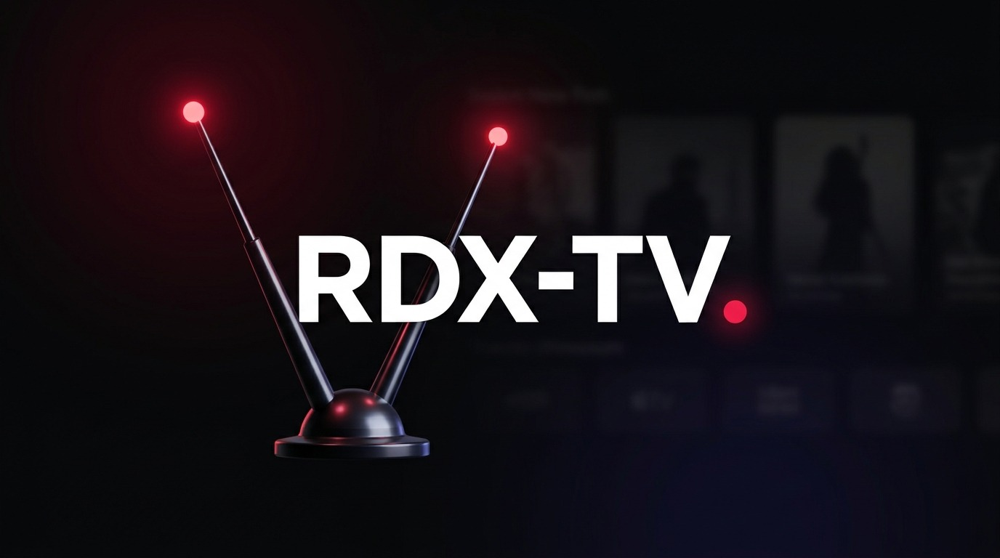
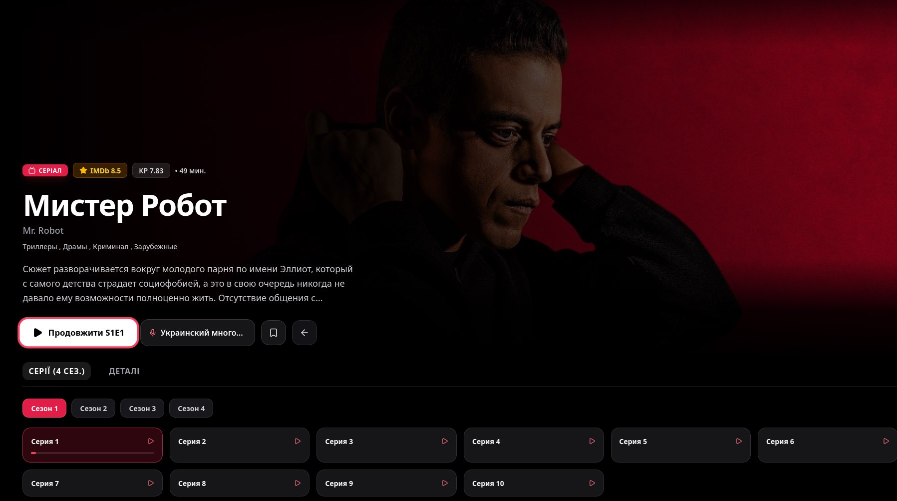

# RDX-TV. v2 — Lightweight Smart TV Streaming Client

<p align="center">
  
</p>

<p align="center">
  <b>Ultra-lightweight 10-foot Smart TV streaming client for HDRezka (and its mirrors) built specifically for 1–2 GB RAM TVs: Android TV (32-bit & 64-bit), Samsung Tizen (<code>.wgt</code>), and LG webOS (<code>.ipk</code>).</b><br/>
  Built with <b>Preact</b>, <b>TypeScript</b>, <b>Tailwind CSS</b>, and <b>native hardware video engines</b> (<b>Media3 / ExoPlayer</b>, <b>Samsung AVPlay</b>, <b>LG webOS HLS</b>) — zero Rust/Tauri overhead, zero Cloudflare relays.<br/>
  <sub>Based on the <a href="https://github.com/thecapibara/RDX">RDX</a> desktop client. Legacy Rust/Tauri v1 is archived in the <code>legacy-rdxtv</code> branch.</sub>
</p>

---

> [!IMPORTANT]
> **🇺🇦 Interface Language Note:**
> The application interface (menus, OSD controls, TV keyboard, and settings) is **in Ukrainian** (`Українська`), with built-in prioritization and `🇺🇦` badge highlighting for Ukrainian voiceover studios.

---

## ⚡ Why v2? (1–2 GB RAM TV Architecture)

| Platform | Native Shell | Hardware Video Engine | Networking & DoH |
| :--- | :--- | :--- | :--- |
| **Android TV (32-bit `armeabi-v7a` & 64-bit `arm64-v8a`)** | Lightweight Kotlin (`android-tv/`) | **Media3 / ExoPlayer** (16 MB buffer cap, `LoudnessEnhancer`) | **OkHttp** + **DoH (`1.1.1.1`)** + `CookieJar` |
| **Samsung Tizen (`.wgt`)** | Packaged Tizen Web App (`tizen/`) | **Samsung `webapis.avplay`** (with `suspend`/`restore`) | Direct mirror fetch (`<access origin="*">`) + mirror auto-failover |
| **LG webOS (`.ipk`)** | webOS App + local Node.js service (`webos/`) | Native `<video>` HLS pipeline | Local **`webos-service`** + **DoH (`1.1.1.1` / `8.8.8.8`)** + `CookieJar` |

- **5.5× smaller JS bundle** than v1 (`~67 KB` gzip main JS, `hls.js` lazy-loaded only as a web fallback).
- **100% local on the TV** — no Cloudflare Workers or external relays required.

---

## ✨ Key Features

- **10-Foot Smart TV / Cinema UI (60 FPS GPU-CSS)**:
  - True OLED (`#000000`) & Obsidian (`#09090b`) themes, 5 accent palettes, and **OLED Care** mode (82% soft white UI text to prevent OLED halation & burn-in).
  - Crisp `w1280` TMDB Hero carousel, **"Continue Watching"** (`Продовжити перегляд`), 10-foot genre modal grid, and Apple TV / Disney+ style release details.
- **TV Remote First Navigation & Built-in TV Keyboard**:
  - Full spatial D-pad navigation (`useTvNavigation` + LIFO `useTvBack`) across cards, filters, settings, player OSD, and modals — including Android TV `Back`, Samsung Tizen `Return` (`10009`), and LG webOS `Back` (`461`).
  - Built-in **UA / EN On-Screen TV Keyboard** inside Search.
- **Native TV Audio Feedback**:
  - Native Android `SoundPool` (`startup.mp3`, `hovercard.mp3`, `opencard.mp3`, `buttonclick.mp3`) and preloaded Web Audio buffers + oscillator fallback on Tizen/webOS.
- **Unified TV Player OSD**:
  - Works seamlessly over **ExoPlayer**, **Samsung AVPlay**, **webOS Native HLS**, and **HLS.js** fallback.
  - Quality selector (`1080p Ultra / 2K / 4K` with `👑` badge), Ukrainian voiceover switcher (`🇺🇦`), seasons & episodes drawer, 15s auto-next countdown, aspect ratio zoom (`Авто / Заповнити / 16:9`), subtitles + sizing, playback speed, sleep timer, Android native audio boost (`100%–200%`), and stream stats HUD (`I`).

---

## 📸 Скріншоти / Screenshots

<p align="center">
  <b>10-foot картка релізу (Apple TV / Disney+ стиль, D-pad фокус, вибір озвучки та серій)</b><br/>
  
</p>

---

## 🎮 TV Remote Controls

| Remote Button | Action |
| :--- | :--- |
| `D-Pad (↑ ↓ ← →)` | Navigate UI / Seek **±10s** in player |
| `OK / Enter` | Select / Open / Play–Pause |
| `Return / Back` | Close modal / Exit player / Double-Back to exit app |
| `Play / Pause / FF / RW` | Native TV media remote playback controls |

---

## 🛠 Development & Build

### Local Browser Development (with built-in dev-only DoH proxy)
```bash
npm install
npm run dev
# Opens at http://localhost:1420
```

### Android TV (32-bit `armeabi-v7a` & 64-bit `arm64-v8a` APKs)
```bash
npm run build:android-assets
cd android-tv && gradle assembleRelease
```

### Samsung Tizen (`.wgt`)
```bash
npm run build:tizen
# Package with Tizen Studio CLI:
# tizen package -t wgt -s <certificate_profile> -- dist-tizen
```

### LG webOS (`.ipk` with local DoH service)
```bash
npm run build:webos
ares-package --no-minify dist-webos webos/service -o artifacts/
```

---

## ⚠️ Disclaimer
**RDX-TV** is an unofficial, open-source third-party client for **HDRezka** developed strictly for educational and personal use. It is not affiliated with or endorsed by HDRezka. This application does **not** host, store, archive, or distribute any copyrighted media files on its own servers — all metadata and video streams are fetched directly from publicly accessible HDRezka mirrors configured by the user.
