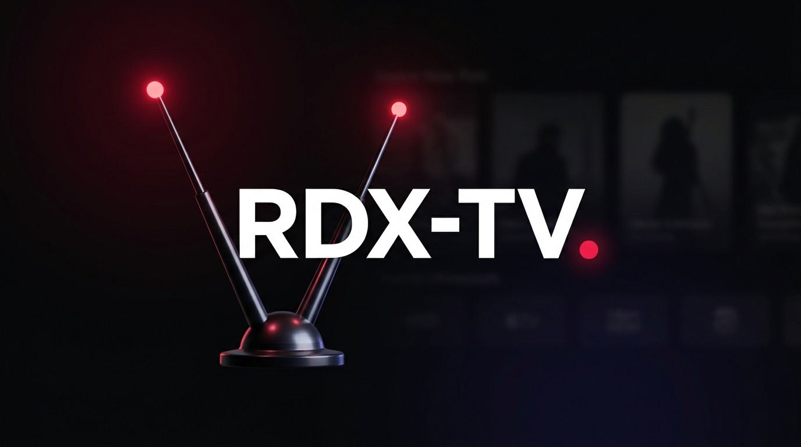
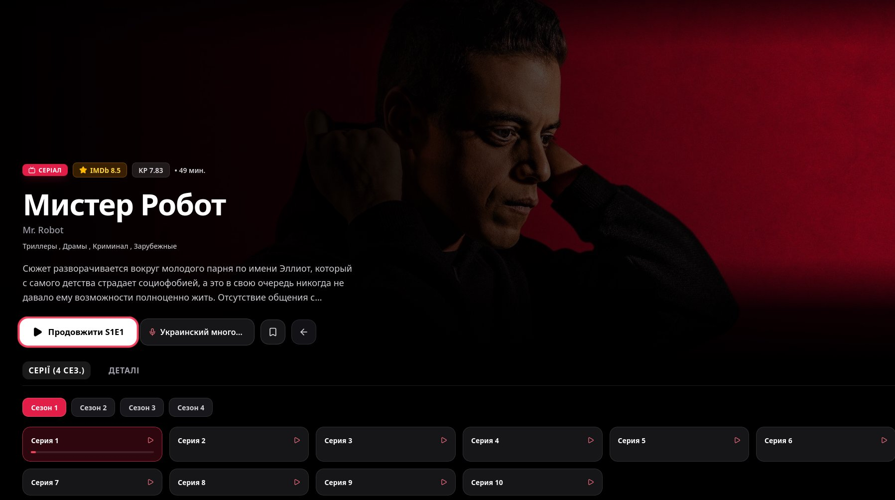

# RDX-TV. — Smart TV Streaming Client (Android TV & Samsung Tizen)

<p align="center">
  
</p>

<p align="center">
  <b>10-foot Smart TV streaming client for HDRezka (and its mirrors) built for Android TV (Tauri v2) and Samsung TV (Tizen `.wgt`) with an Apple TV / Google TV inspired interface.</b><br/>
  Built with <b>Rust (Tauri v2)</b>, <b>React 19</b>, <b>TypeScript</b>, <b>Tailwind CSS</b>, and <b>HLS.js</b>.<br/>
  <sub>Based on the <a href="https://github.com/thecapibara/RDX">RDX</a> desktop client.</sub>
</p>

---

> [!IMPORTANT]
> **🇺🇦 Interface Language Note:**
> The application interface (menus, OSD controls, TV keyboard, and settings) is **in Ukrainian** (`Українська`), with built-in prioritization and `🇺🇦` badge highlighting for Ukrainian voiceover studios.

---

## ✨ Key Features

- **10-Foot Smart TV / Cinema UI**:
  - Matte obsidian (`#09090b`) & crimson (`#e11d48`) design language with high-contrast D-pad focus rings and smooth spatial navigation (`Arrow` keys, `OK / Enter`, `Return / Back`).
  - Full-bleed hero carousel with TMDB 1080p/4K backdrop lookup, **"Continue Watching"** (`Продовжити перегляд`) swimlane with episode progress, and category carousels.
  - Apple TV / Disney+ style release detail screen with Ukrainian voiceover (`🇺🇦`) prioritization, season/episode picker, and instant playback.
- **TV Remote First Navigation & Built-in TV Keyboard**:
  - Full spatial D-pad navigation (`useTvNavigation` / `useTvBack`) across cards, filters, settings, player OSD, and modals — including Samsung Tizen `Return` (`keyCode 10009`) and Android TV `Back`.
  - Built-in **UA / EN On-Screen TV Keyboard** inside Search alongside native Samsung Tizen IME (`65376` / `65385`) support.
- **Hybrid TV Audio Engine**:
  - Native `rodio` playback on desktop testing (`startup.mp3`, `hovercard.mp3`, `opencard.mp3`, `buttonclick.mp3`) + `AudioContext.decodeAudioData` MP3 preloading on **Android TV** and **Samsung Tizen**, plus Web Audio boot splash `bubbles` SFX.
- **Custom TV Video Player (`HLS` + `MP4`)**:
  - D-pad controllable OSD (seek `← / →`, Play/Pause `OK`, media remote keys, voiceovers, seasons/episodes, quality up to `1080p Ultra / 4K`, speed, sleep timer, and stream diagnostics).
  - Auto-saves playback progress every 5 seconds to SQLite (`app_data_dir()` on Android TV / desktop) or `localStorage` on Tizen.
- **HDRezka Mirror, DoH & Tizen HTTP Bridge**:
  - Built-in DNS-over-HTTPS (DoH), Anubis PoW solver, dynamic mirror failover, `HTTP` / `SOCKS5` proxy support, and **RDX Bridge URL** transport (`invokeBridge`) for Samsung Tizen `.wgt`.

---

## 📸 Скріншоти / Screenshots

<p align="center">
  <b>10-foot картка релізу (Apple TV / Disney+ стиль, D-pad фокус, вибір озвучки та серій)</b><br/>
  
</p>

---

## 🎮 TV Remote Controls

| Remote Button | Action |
| :--- | :--- |
| `D-Pad (↑ ↓ ← →)` | Navigate UI / Seek **±10s** in player |
| `OK / Enter` | Select / Open / Play–Pause |
| `Return / Back` | Close modal / Exit player / Back |
| `Play / Pause / FF / RW` | Native TV media remote playback controls |

---

## 🛠 Development & Build

### Prerequisites
- **Rust** (`1.77+`) & **Node.js** (`20+`)
- For Desktop testing on Linux: `webkit2gtk-4.1` and `gstreamer1` plugins
- For **Android TV**: Android SDK / NDK + `rustup target add aarch64-linux-android`
- For **Samsung Tizen**: Tizen Studio CLI (`tizen`, `sdb`)

### Desktop Development Preview
```bash
npm install
npm run tauri dev
```

### Build for Samsung Tizen (`.wgt` staging)
```bash
npm run build:tizen
# Package with Tizen Studio CLI:
# tizen package -t wgt -s <certificate_profile> -- dist-tizen
```

### Build for Android TV (`.apk`)
```bash
npx tauri android init
npx tauri android build
```

---

## ⚠️ Disclaimer
**RDX-TV** is an unofficial, open-source third-party client for **HDRezka** developed strictly for educational and personal use. It is not affiliated with or endorsed by HDRezka. This application does **not** host, store, archive, or distribute any copyrighted media files on its own servers — all metadata and video streams are fetched directly from publicly accessible HDRezka mirrors configured by the user.
